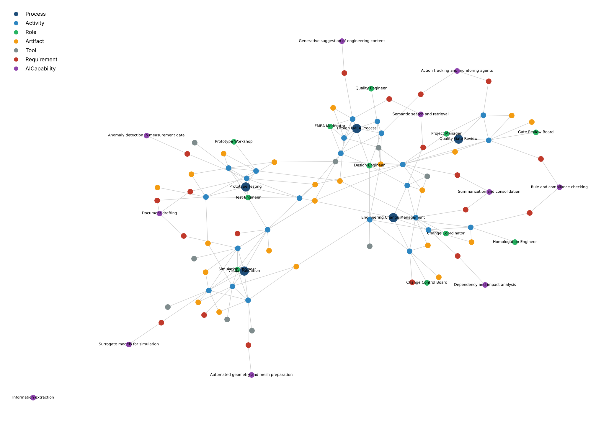
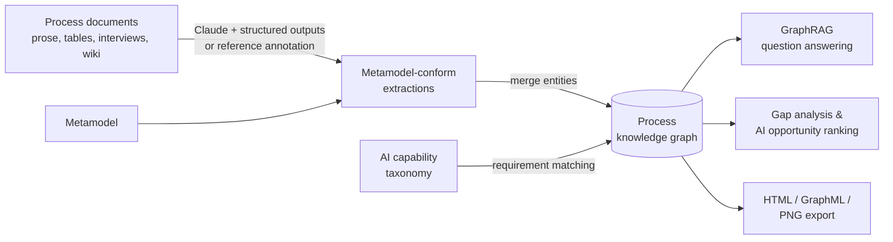

# Process Knowledge Graph + GraphRAG

A small, reproducible demo of **AI-aided process intelligence for product development**. It turns
heterogeneous process documentation into a knowledge graph based on an explicit metamodel, links
process requirements to a taxonomy of AI capabilities, and answers questions about the process
landscape with **GraphRAG**. The GraphRAG retriever is evaluated against a classic text-chunk RAG baseline.



*101 nodes, 170 edges: five development processes (dark blue) with their activities, roles,
artifacts, tools, process requirements (red), and the AI capabilities (purple) that could address them.*

## The idea

AI tools are evolving faster than development organisations can integrate them. The limiting factor
is often not the model but the **quality, structure and accessibility of the process knowledge** the
model works with. This demo explores one path from scattered documents to targeted AI support:

1. **Metamodel** ([`data/metamodel.yaml`](data/metamodel.yaml)): a machine- and human-readable
   definition of entity types (Process, Activity, Role, Artifact, Tool, Requirement, AICapability) and
   typed relations with domain and range (e.g. `Activity -PERFORMED_BY-> Role`). It drives
   extraction, validation and retrieval.
2. **Structured knowledge base from heterogeneous documents**: five synthetic process documents in
   deliberately different formats (prose, a work instruction, a table, an interview transcript and a
   wiki page) are transformed into metamodel-conform extractions. This is done by Claude with
   structured outputs, or loaded from a manual reference annotation for full reproducibility. Every
   requirement carries a verbatim evidence quote.
3. **Linking process requirements to AI capabilities**: a tool-independent capability taxonomy
   ([`data/ai_capabilities.yaml`](data/ai_capabilities.yaml)) with maturity levels. A transparent
   matcher creates `Requirement -ADDRESSED_BY-> AICapability` edges, which are evaluated against an
   expert mapping.
4. **Using the knowledge**:
   - **GraphRAG question answering**: entity linking, then personalised PageRank, then
     *schema-aware* ranking (the metamodel's query terms recognise that "Which roles..." asks for
     Role nodes), then context for the LLM.
   - **Graph analyses without an LLM**: documentation gaps, artifacts that connect processes, and a
     ranked list of AI opportunities (effort × match score × capability maturity) as input for a
     cost-benefit discussion.



## Quick start

```bash
pip install -r requirements.txt

python -m procgraph build        # build the graph -> build/graph.{json,graphml,html,png}
python -m procgraph gaps         # documentation gaps and ranked AI opportunities
python -m procgraph evaluate     # GraphRAG vs. chunk RAG, capability matching vs. expert
python -m procgraph ask "What happens when a prototype test fails, and which roles are involved afterwards?"
```

Everything above runs offline. With Claude API credentials (`export ANTHROPIC_API_KEY=...`):

```bash
python -m procgraph ask "Which AI capabilities could support the impact analysis of engineering changes?"
                                                          # retrieves context and generates an answer
python -m procgraph extract                               # extract the documents with Claude
python -m procgraph --extractions build/llm_extractions evaluate   # ...and score them against the reference
```

`build/graph.html` is an interactive view of the graph; `graph.graphml` opens in Gephi or yEd, or can be
imported into Neo4j. Run the tests with `python -m pytest`.

## Example: what the graph reveals

`python -m procgraph gaps` (excerpt):

| Requirement | Process | h/month | Best AI capability | Maturity | Priority |
|---|---|---|---|---|---|
| Detect anomalies in measurement data | Prototype Testing | 150 | Anomaly detection in measurement data | medium | 55.8 |
| Consolidate department assessments | Engineering Change Management | 160 | Summarization and consolidation | high | 54.6 |
| Find earlier similar changes | Engineering Change Management | 120 | Semantic search and retrieval | high | 32.4 |
| Reduce meshing effort | Virtual Validation | 200 | Automated geometry and mesh preparation | low | 28.6 |
| Reuse lessons learned from previous FMEAs | Design FMEA Process | 90 | Semantic search and retrieval | high | 21.1 |

The structural analysis also flags, for example:
- **Interfaces to undocumented processes**: the *Test Request*, *Requirements Specification*,
  *Bill of Materials* and *Gate Criteria Checklist* are used, but no documented activity produces them.
- **Outputs nobody uses**: the *Correlation Report* and the *CCB Decision Log* are produced but never consumed.
- **Needs that are not an AI problem**: *Link test and simulation data* matches no AI capability.
  It is a data-integration problem, a useful negative result for tool selection.

(Effort figures are synthetic placeholders. In a real study they would come from interviews or time measurement.)

## Results

All numbers come from `python -m procgraph evaluate --sweep` on the reference annotation.

**Retrieval**: share of the facts needed for an answer that appear in the retrieved context. There
are 12 questions: 5 answerable from one document and 7 that need facts from several documents. Both
retrievers use the same TF-IDF text similarity and the same context size (about 5,000 characters of
an 11,600-character corpus), so the comparison isolates the effect of the graph.

| Retriever | Single-document | Multi-document | All |
|---|---|---|---|
| Chunk RAG (baseline) | 1.00 | 0.87 | 0.92 |
| GraphRAG, without schema-aware ranking | 1.00 | 0.66 | 0.80 |
| **GraphRAG, with schema-aware ranking** | 1.00 | 0.87 | 0.92 |

Ablation over context size (multi-document recall, GraphRAG with / without schema-aware ranking vs. chunk RAG):

| Graph nodes in context | ≈ Characters | GraphRAG (schema-aware) | GraphRAG (plain) | Chunk RAG |
|---|---|---|---|---|
| 20 | 5,000 | 0.87 | 0.66 | 0.87 |
| 25 | 6,300 | 0.87 | 0.85 | 0.90 |
| 30 | 7,700 | 0.95 | 0.92 | 0.90 |

**Capability matching** against the expert mapping (19 requirements): top-1 accuracy 0.89, link
precision 1.00, link recall 0.70. Its two misses are requirements whose wording has little lexical
overlap with the right capability ("Prepare change summary for the board").

### What the results do and do not show

- On a corpus this small, plain chunk RAG already sees almost half of all text in every context, so
  it is a strong baseline. GraphRAG matches it and pulls ahead only with larger contexts. **This
  demo does not show that GraphRAG retrieves better.** The question set is tiny, and it was used
  during development.
- Using the metamodel at query time clearly matters: without schema-aware ranking, multi-document
  recall drops from 0.87 to 0.66.
- The graph's main value here lies **beyond retrieval**. The gap analysis, cross-process artifact
  flows and the requirement-to-capability ranking are graph queries that text retrieval cannot
  answer at all. Every retrieved fact is traceable to a typed relation and an evidence quote.

## Limitations and next steps

- **Synthetic data.** All documents, roles and effort numbers are invented for illustration and
  describe no real organisation. The next step is real process documentation and a larger,
  independently written question set.
- **Lexical similarity.** Entity linking, the chunk baseline and capability matching all use TF-IDF
  so they can be inspected and run offline. Embedding models or LLM-based matching would likely
  raise matching recall; the evaluation harness is ready to compare them.
- **Extraction quality** at scale needs measurement. `evaluate --extractions` scores LLM extractions
  against the reference annotation with exact-match precision and recall, a strict lower bound.
- **Effort and benefit** figures need empirical grounding (interviews, observation, time
  measurement) before the opportunity ranking can support a real cost-benefit analysis.
- **Process models.** Importing BPMN models directly would complement the document-based extraction.

## Repository layout

```
data/
  metamodel.yaml          entity and relation types (human- and machine-readable)
  ai_capabilities.yaml    AI capability taxonomy with maturity levels
  documents/              five synthetic process documents in different formats
  extractions/            reference annotation (one YAML per document)
  evaluation.yaml         evaluation questions and expert capability mapping
procgraph/
  metamodel.py            loading, validation, schema-aware query typing
  extract.py, llm.py      LLM extraction with Claude structured outputs
  build.py                graph construction, entity merging, capability matching
  retrieve.py             GraphRAG retriever and chunk-RAG baseline
  answer.py               answer generation
  analysis.py             gap analysis, cross-process links, AI opportunity ranking
  evaluate.py             retrieval, matching and extraction evaluation
  visualize.py            interactive HTML and static PNG
tests/                    data consistency and pipeline tests
```

## License

MIT, see [LICENSE](LICENSE).
